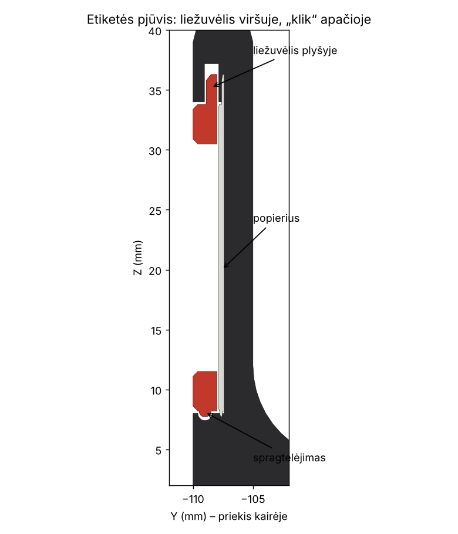

# Gabriele
Jos darbai

## Raktų dėžutė (Fakto Auto / Nissan) – 22 cm ilgio (nuo etiketės iki galo) × 18 cm pločio × 7 cm aukščio


| Failas | Kas tai |
|---|---|
| `blender/raktu_deze.py` | Parametrinis Blender skriptas – visi matmenys failo viršuje |
| `blender/raktu_deze.blend` | Paruoštas Blender failas |
| `stl/deze_180x220x70.stl` | Pati dėžutė |
| `stl/etiketes_remelis.stl` | **Pagrindinis variantas:** juodas spragtelintis rėmelis su langeliu, už jo – keičiama popierinė etiketė |
| `labels/etiketes_A4.pdf` | Popierinės etiketės spausdinimui (A4, 20 vnt., 98 × 24 mm); savo tekstams – `labels/etiketes.py` |
| `stl/etiketes_plokstele_su_tekstu.stl` | Variantas be popieriaus: plokštelė su iškiliu tekstu „01 \| ATSARGINIAI RAKTAI“ |
| `stl/etiketes_plokstele_be_teksto.stl` + `etiketes_tekstas_tik_spalva.stl` | Tas pats, atskirai dviem spalvoms (AMS / MMU) |

### Dizainas
- **Matmenys:** priekinė sienelė su etikete – 18 cm, nuo etiketės iki galinės sienelės – 22 cm, aukštis – 7 cm.
- **Forma:** lygi dėžutė be skylių ir griovelių. 16 mm suapvalinti kampai, 5 mm sienelės, pilnai apvalus viršutinis kraštas, 8 mm vidinis dugno apvalinimas (raktus lengva išsemti), priekyje minkšta įduba.
- **Etiketė:** priekyje kišenė 100 × 26 × 2,6 mm, į ją įsistato juodas rėmelis (2 mm), už jo – popierius.
  - **Viršuje** rėmelis turi 84 mm ilgio liežuvėlį, kuris įlenda į paslėptą plyšį sienelėje – iš priekio jo nesimato, rėmelis negali atšokti viršuje.
  - **Apačioje** – spragtelėjimas: 70 mm iškilimas įšoka į griovelį („klik“).
  - Įdėti: liežuvėlį įkišti į plyšį, apačią prispausti iki „klik“. Išimti: nagu už įpjovos apačioje patraukti apačią į save, tada rėmelį žemyn.
  - Rėmelį spausdink tuo pačiu juodu plastiku – susilieja su dėžute, matosi tik baltas popierius. Popieriaus dydis: **98 × 24 mm** (matomas langelis 92 × 19 mm). Galima uždėti skaidrią plėvelę (iki 0,5 mm).




### Spausdinimas
- **Spausdintuvo laukas:** reikia bent 180 × 220 mm (Bambu A1/P1/X1, Prusa MK4/Core One, Ender 3 – telpa). Jei laukas mažesnis – pasakyk, padalinsiu į 2 dalis su jungtimis.
- **Dėžutė:** stačia (dugnu ant pagrindo), be atramų. PETG arba PLA (matinė juoda – kaip nuotraukoje), 0,2 mm sluoksnis, 3 sienelės, 15 % gyroid. Realiai ~200–250 g plastiko.
- **Rėmelis / plokštelė:** gulint (liežuvėlis ant pagrindo), be atramų. Plokštelė su tekstu: vienu spausdintuvu – spalvos keitimas (M600 / „Add pause“) 2,0 mm aukštyje.
- **Patarimas:** pirma atsispausdink tik rėmelį ir dėžutės priekio gabalą (slicer'yje „cut“), kad patikrintum spragtelėjimą. Per kietai – skripte `SNAP_RIDGE_R = 0.4`, per laisvai – `0.6`.

### Etiketės keitimas
1. Atsispausdink `labels/etiketes_A4.pdf` (100 % mastelis), iškirpk.
   Savo tekstai: `python labels/etiketes.py "07:KLIENTŲ RAKTAI" "08:"` (arba `--csv sarasas.csv`, eilutės `numeris;tekstas`).
2. Nagu už įpjovos apačioje patrauk rėmelio apačią, ištrauk jį žemyn. Įdėk popierių (ir, jei nori, 98 × 24 mm skaidrią plėvelę), liežuvėlį įkišk į plyšį, apačią prispausk iki „klik“.

### Šriftas
Etiketės tekstas – **Inter SemiBold** (`blender/fonts/`, SIL OFL licencija), didžiosios raidės su platesniais tarpais.

### Kaip keisti
Atidaryk `blender/raktu_deze.py` Blender'yje (Scripting → Open → Run Script) arba:
```
blender -b -P blender/raktu_deze.py -- --out .
```
Peržiūros renderiai: `python blender/render.py --out renders`.

Keisk parametrus failo viršuje (pvz. `LABEL_NUMBER = "02"`, `LABEL_TEXT = "..."`, matmenys) – sugeneruos naują `.blend` ir visus STL.

## Claude skills ir įrankiai
Žr. [SKILLS.md](SKILLS.md).
