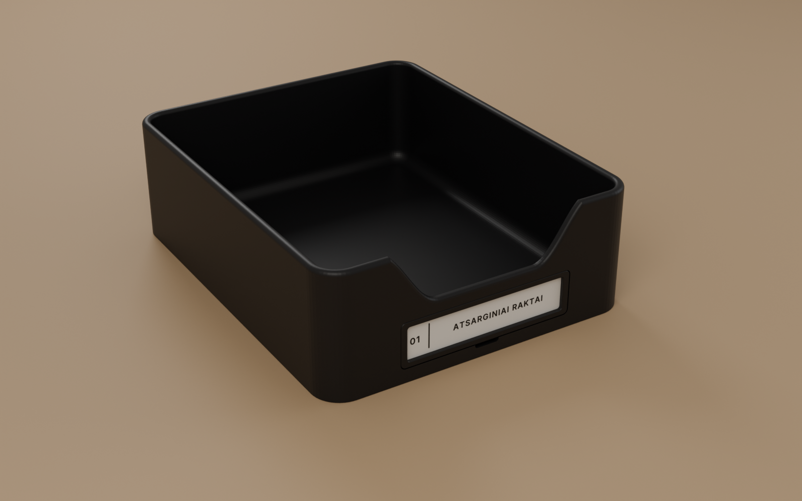
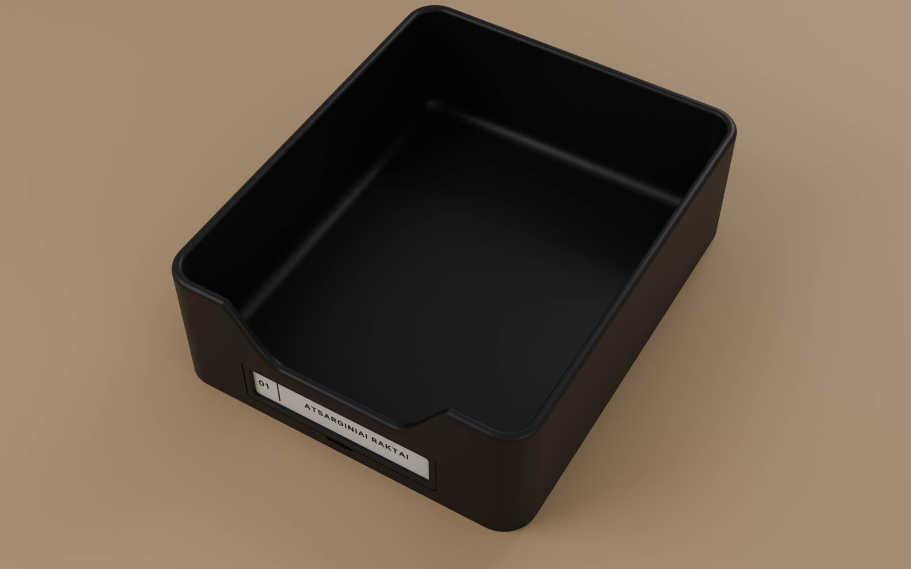
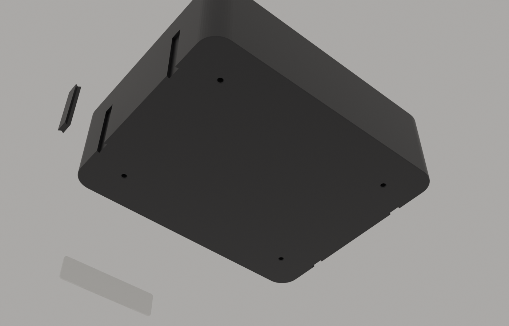

# Gabriele
Jos darbai

## Raktų dėžutė (Fakto Auto / Nissan) – 220 × 180 × 70 mm



| Failas | Kas tai |
|---|---|
| `blender/raktu_deze.py` | Parametrinis Blender skriptas – visi matmenys failo viršuje |
| `blender/raktu_deze.blend` | Paruoštas Blender failas |
| `stl/deze_220x180x70.stl` | Pati dėžutė |
| `stl/etiketes_remelis.stl` | Spragtelintis rėmelis su langeliu (už jo – popierinė etiketė) |
| `stl/etiketes_plokstele_su_tekstu.stl` | Variantas be popieriaus: plokštelė su iškiliu tekstu „01 \| ATSARGINIAI RAKTAI“ |
| `stl/etiketes_plokstele_be_teksto.stl` + `etiketes_tekstas_tik_spalva.stl` | Tas pats, atskirai dviem spalvoms (AMS / MMU) |
| `stl/jungtis_dovetail.stl` | Jungtis dviem gretimoms dėžutėms sujungti |

### Dizainas
- **Forma:** 16 mm suapvalinti kampai, 5 mm sienelės, pilnai apvalus viršutinis kraštas, 8 mm vidinis dugno apvalinimas (raktus lengva išsemti), priekyje įduba su suapvalintais kraštais – kaip nuotraukoje.
- **Etiketė:** priekyje 100 × 26 × 2,2 mm kišenė. Rėmelis įsispaudžia ir spragteli (iškilimai rėmelio kraštuose, grioveliai kišenėje). Apačioje per vidurį – įpjova nagui, kad rėmelį galėtum išimti.
  Popieriaus dydis: **98 × 24 mm** (matomas langelis 88 × 17 mm). Galima uždėti skaidrią plėvelę (iki 0,4 mm).
- **Tvirtinimas į spintelę:** 4 skylės dugne **iš apačios** (Ø4,0 × 6 mm) – M3 įlydomoms įvorėms (heat-set inserts, M3 × 5,7). Dugnas 8 mm storio, todėl iš vidaus nieko nesimato. Prisukama **M3 × 8** varžtais per lentyną/plokštelę iki ~3 mm storio (storesnei lentynai – ilgesni varžtai). Jei nori sukti tiesiai į plastiką be įvorių – skripte `M3_HOLE_D = 2.6`.
- **Dėžučių jungimas:** šonuose po 2 žemus (25 mm) dovetail griovelius – atviri tik apačioje, iš vidaus ir iš viršaus nesimato. Dėžutes pastatai vieną šalia kitos, apverti, įstumi jungtį iš apačios – laikosi tvirtai be klijų.





### Spausdinimas
- **Spausdintuvo laukas:** reikia bent 220 × 180 mm (Bambu A1/P1/X1, Prusa MK4/Core One, Ender 3 – telpa). Jei laukas mažesnis – pasakyk, padalinsiu į 2 dalis su jungtimis.
- **Dėžutė:** stačia (dugnu ant pagrindo), be atramų. PETG arba PLA (matinė juoda – kaip nuotraukoje), 0,2 mm sluoksnis, 3 sienelės, 15 % gyroid. ~530 cm³ tūris, bet su užpildu realiai ~250–300 g.
- **Rėmelis / plokštelė:** gulint, be atramų. Plokštelė su tekstu: vienu spausdintuvu – spalvos keitimas (M600 / „Add pause“) 1,6 mm aukštyje.
- **Jungtis:** gulint ant plokščio šono, be atramų. Jei per kieta/per laisva – skripte `DT_CLEAR`.

### Šriftas
Etiketės tekstas – **Inter SemiBold** (`blender/fonts/`, SIL OFL licencija), didžiosios raidės su platesniais tarpais.

### Kaip keisti
Atidaryk `blender/raktu_deze.py` Blender'yje (Scripting → Open → Run Script) arba:
```
blender -b -P blender/raktu_deze.py -- --out .
```
Peržiūros renderiai: `python blender/render.py --out renders`.

Keisk parametrus failo viršuje (pvz. `LABEL_NUMBER = "02"`, `LABEL_TEXT = "..."`, matmenys) – sugeneruos naują `.blend` ir visus STL.

## Claude skills ir įrankiai
Žr. [SKILLS.md](SKILLS.md).
